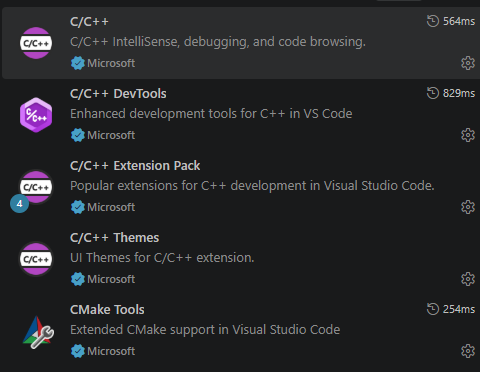

# Практика 01 Первая программа

## 1. Настройка VSCode

Установил расширения для С++

## 2. Собрал и  запустил [`main.cpp`](main.cpp)
Подробнее в отчете [`report.md`](report.md)

## 3. Выполнил задания из [`tasks.md`](tasks.md).
