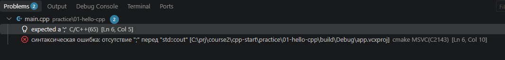
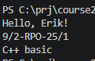

# Отчёт по практике 01

| Поле | Данные |
|---|---|
| Студент | Эрик Кожемякин |
| Группа | 9/2-РПО-25/1 |
| Дата | 28.10.2026 |
| Среда и компилятор | Заполнить |

## Что выполнено

- [✅] Стартовая программа запущена
- [✅] Добавлена карточка в консоли
- [✅] Изучено и исправлено сообщение об ошибке
- [✅] Изменения отправлены на GitHub

## Как запустить

В VSCode при открытии папки с CMakeLists.txt автоматически появляются кнопки сборки и запуска


## Вывод программы

```text
Hello, C++!
```

## Разбор ошибки

После дополнения программы, не поставил одну из ;



Какое сообщение показал компилятор? 
> error C2143: синтаксическая ошибка: отсутствие ";" перед "std::cout"

Что пришлось исправить?
поставить ;

## Вывод новой версии программы



## Ответы на вопросы

1. Начало выполнения программы: функция main
2. Назначение `std::cout`: обращение к переменной cout, которая находится в пространстве имен std
3. Назначение `\n`: Переход в начало следующей строки, что бы вывод программы не слился.
4. Проверка отправки на GitHub: git status показывает наличие измененных и новых файлов.

## Что осталось непонятным

Вопросов пока нет.

Я использовал ИИ для помощи по настройке VSCode
