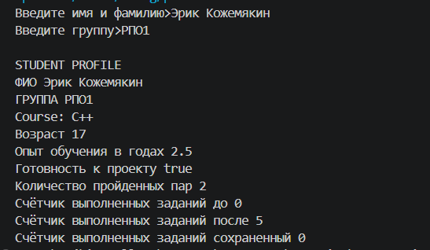
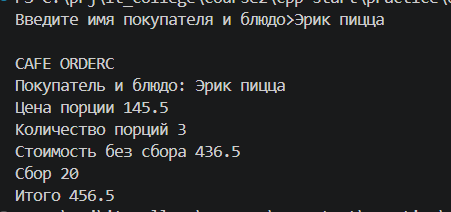
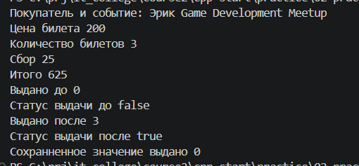

# Отчёт по практической работе: Пары 1 и 2

## [Исходные задания](tasks.md)

## Задание 1. Паспорт студента [`task01-profile`](task01-profile/main.cpp)

### Исходный код [`main.cpp`](task01-profile/main.cpp)

### Результаты запуска

### Анализ и ответы на контрольные вопросы
1. **Выбор типов данных:**
   - `age` имеет тип `int`, поскольку возраст человека в годах выражается дискретным целым числом.
   - `experience` имеет тип `double`, так как стаж/опыт обучения может содержать дробную часть года (например, 1.5 или 2.5 года).
   - `project_ready` имеет тип `bool`, так как отражает бинарное логическое состояние: студент либо готов к проекту (`true`), либо не готов (`false`).
2. **Момент создания копии и её неизменность:**
   - Переменная `complete_tasks_copy` была создана и инициализирована значением переменной `complete_tasks` **до** выполнения операции изменения `complete_tasks += 5;`.
   - В C++ при инициализации базовых типов создаётся независимая копия значения в памяти. Поэтому последующее изменение исходной переменной `complete_tasks` никак не влияет на ячейку памяти, выделенную под `complete_tasks_copy`, и в ней остаётся первоначальный `0`.
3. **Назначение константы `complete_pair`:**
   - Ключевое слово `const` защищает количество пройденных пар от непреднамеренного изменения в коде программы, так как это фиксированное на текущий момент справочное значение.

## Задание 2. Заказ в учебном кафе [`task02-cafe`](task02-cafe/main.cpp)

### Исходный код [`main.cpp`](task02-cafe/main.cpp)

### Результаты запуска

### Анализ и ответы на контрольные вопросы
1. **Выбор типов данных:**
   - Цена порции (`portion_price`), сбор (`order_fee`) и итоговые суммы (`order_price`, `order_total`) хранятся в типе `double`, так как денежные величины могут иметь дробные значения (копейки).
   - Количество порций (`portion_cnt`) хранится в `int`, так как штучный заказ блюд измеряется исключительно целыми положительными единицами.
2. **Ввод строк:**
   - Использование `std::getline(cin, ...)` позволяет корректно считывать строки целиком, не разделяя текст по пробелам, благодаря чему имя клиента и сложные названия блюд (например, `Rice with chicken`) считываются в одну переменную целиком.

## Задание 3. Билет участника [`task03-ticket`](task03-ticket/main.cpp)

### Исходный код [`main.cpp`](task03-ticket/main.cpp)

### Результаты запуска

### Анализ и ответы на контрольные вопросы
1. **Откуда счётчик получает новое значение:**  
   Счётчик `issued_tickets` получает новое значение в результате явного оператора присваивания `issued_tickets = ticket_cnt;`, куда передаётся количество запрошенных в заказе билетов.
2. **Когда создаётся копия и почему она не изменилась:**  
   Копия `issued_tickets_copy` создаётся строго **до** момента подтверждения выдачи. Значение в копии остаётся равным `0`, так как копия независима и хранит снимок состояния на момент создания.
3. **Единоразовый сервисный сбор:**  
   Сервисный сбор `order_fee` начисляется на транзакцию (обслуживание всего заказа), а не на каждый отдельный билет в заказе, поэтому в формуле он суммируется один раз (`ticket_price * ticket_cnt + order_fee`).
4. **Различие между инициализацией и присваиванием:**
   - **Инициализация** (`bool issue_ack = false;`) происходит в момент выделения памяти для переменной и задаёт её стартовое состояние.
   - **Присваивание** (`issue_ack = true;`) — это оператор, который перезаписывает уже существующее значение в выделенной ранее памяти во время выполнения программы при наступлении определённого события (фактическая выдача билетов).

## Заключение
В ходе выполнения практической работы были закреплены навыки:
1. Создания консольных проектов на C++23 с поддержкой кириллицы (UTF-8).
2. Использования строк `std::string` и потокового ввода целых строк через `std::getline`.
3. Корректного подбора фундаментальных типов данных под предметную область задачи (`int` для количеств и целочисленных сумм, `double` для дробных чисел, `bool` для логических признаков).
4. Разграничения констант (`const`) и изменяемых переменных, а также понимания семантики копирования значений при присваивании.
